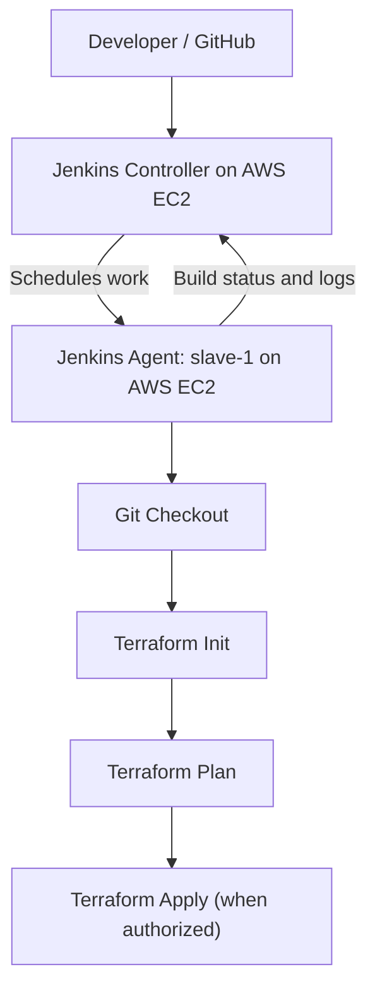

# Jenkins Controller–Agent Hands-On Practice on AWS EC2


## Overview

This repository documents my **Jenkins Day 2 hands-on practice** with **Controller–Agent architecture** (formerly called *Master–Slave*) on **AWS EC2**. The exercise covered configuring a Jenkins agent, exploring node settings and remote execution, creating a Jenkins Pipeline, practicing GitHub checkout and Terraform stages, inspecting build logs, and troubleshooting pipeline failures.

**Classification:** Hands-on learning lab, not a production deployment.

> This README is based on my lab screenshots and observed practice. The step-by-step instructions below are a reproducible guide; where exact commands or settings were not legible in the evidence, they are identified as examples rather than claimed to be the original commands. No screenshots or secrets are included.

## Learning objectives

- Understand the responsibilities of Jenkins Controllers and Agents.
- Configure Jenkins agents on AWS EC2.
- Learn about agent labels, executor counts, and remote working directories.
- Create and run Pipeline-as-Code scripts with Groovy.
- Explore Git checkout and Terraform workflow stages.
- Read **Stage View** and **Console Output** to troubleshoot failed builds.

## Technologies

| Tool | Purpose |
|---|---|
| Jenkins | Pipeline orchestration, job scheduling, node management |
| AWS EC2 | Linux servers used for Jenkins lab setup |
| Java | Jenkins controller/agent runtime |
| Linux / SSH | Server configuration and remote connectivity |
| Groovy / Jenkins Pipeline | Pipeline definition |
| Git / GitHub | Source checkout during pipeline practice |
| Terraform | Infrastructure-as-Code pipeline stages |

## Architecture



The **Controller** manages jobs, node configuration, and schedules work. The **Agent** can execute jobs assigned to it. A pipeline stage only runs on an agent if the pipeline configuration and available executor/node selection direct it there.

## Prerequisites

- AWS account with permissions to create or use EC2 instances.
- Linux EC2 instances with suitable security groups.
- Jenkins installed and running on the intended controller instance.
- Compatible Java versions on controller and agent.
- Jenkins administrator access for configuring nodes.
- A secure mechanism for connecting controller and agent (for example, SSH with a stored Jenkins credential).
- Git and Terraform on the node where their corresponding stages will execute.
- An appropriate GitHub repository if practicing source checkout.

> **Security:** Never commit private SSH keys, Jenkins API tokens, AWS credentials, Terraform state, or sensitive console logs. Use Jenkins Credentials and least-privilege access.

## Step-by-step hands-on walkthrough

### Step 1 — Prepare the AWS EC2 environment

Create or start Linux EC2 instances for the Jenkins Controller and Agent. Ensure the machines can communicate through appropriately restricted security-group rules.

Connect to each instance and check the operating system and Java installation:

```bash
uname -a
java -version
```

If Java needs installing, choose a JDK version compatible with your Jenkins version and agent setup. Confirm the Jenkins service is reachable using your configured URL or tunnel.

**Observed in practice:** AWS EC2 and Linux/Java environment preparation.

### Step 2 — Open Jenkins and explore node management

1. Sign in to the Jenkins web interface.
2. Select **Manage Jenkins**.
3. Open **Nodes** (or **Manage Nodes and Clouds**, depending on Jenkins version).
4. Review the controller node and the available agent-management options.

**Observed in practice:** Jenkins node management screens.

### Step 3 — Create an agent node

In the Jenkins node-management page:

1. Choose **New Node**.
2. Enter a node name, such as `slave-1` (the name used in this lab).
3. Select a **Permanent Agent** if using a persistent EC2 instance.
4. Configure its settings:
   - **Remote root directory:** a writable agent work directory.
   - **Labels:** labels to use when selecting the agent in pipelines.
   - **Number of executors:** limit based on machine resources.
   - **Usage:** decide whether it accepts any suitable job or label-matched jobs.
   - **Launch method:** choose the connection method that matches your environment.

Save the node configuration.

**Observed in practice:** Agent named `slave-1` and settings for node properties.

### Step 4 — Connect and verify the agent

For SSH-launched agents, configure an SSH credential in Jenkins, specify the agent host, and ensure the controller can reach the agent over SSH. Verify that the configured user can write to the agent's remote root directory and that a compatible Java installation exists.

In Jenkins:

1. Open the node's page.
2. Review its agent connection/log output.
3. Verify it is **Online** before scheduling a build.
4. Check that available executors are shown.

If the agent remains offline, inspect the launcher log, network/security-group rules, SSH credentials, Java availability, and file permissions.

> The screenshots document agent configuration and pipeline execution practice; they do **not** conclusively prove that every pictured pipeline stage ran on `slave-1`.

### Step 5 — Create a Jenkins Pipeline job

1. From the Jenkins dashboard, select **New Item**.
2. Enter a descriptive Pipeline job name.
3. Choose **Pipeline**.
4. Configure the Pipeline section with your script or a Jenkinsfile from source control.
5. Save the job.

**Observed in practice:** Jenkins Pipeline job and Pipeline script configuration.

### Step 6 — Learn how to target the agent explicitly

An illustrative **Declarative Pipeline** to verify scheduling on the agent is:

```groovy
pipeline {
    agent { label 'your-agent-label' }

    stages {
        stage('Verify Agent') {
            steps {
                sh 'hostname'
                sh 'pwd'
                sh 'java -version'
            }
        }
        stage('Verify Tools') {
            steps {
                sh 'git --version'
                sh 'terraform version'
            }
        }
    }
}
```

Replace `your-agent-label` with a label you assigned to the agent. This is an **optional example for reproducing and verifying agent execution**, not a transcription of the original lab script. The example assumes a Linux agent with shell access and the relevant tools installed.

To confirm execution, run **Build Now** and check **Console Output** for a line such as `Running on slave-1` (or the actual node name).

### Step 7 — Explore Git checkout and Terraform stages

In this lab, I practiced a Jenkins pipeline with stages corresponding to:

```text
Git Checkout → Terraform Init → Terraform Plan → Terraform Apply
```

The purpose of each stage:

| Stage | What it does |
|---|---|
| Git Checkout | Retrieves source code / Terraform files |
| Terraform Init | Initializes Terraform providers and backend |
| Terraform Plan | Shows proposed infrastructure changes |
| Terraform Apply | Applies approved infrastructure changes |

For safe local experimentation, the basic commands are:

```bash
terraform init
terraform fmt -check
terraform validate
terraform plan
```

> **Important:** Running `terraform apply` can create or alter billable AWS resources. Use only an authorized lab account, review the plan, and require approval before applying. Pipeline execution and green stages alone do not establish which AWS resources were created.

### Step 8 — Run the pipeline

1. Select the configured Jenkins Pipeline job.
2. Click **Build Now**.
3. Open **Console Output** to review live and completed logs.
4. Open **Stage View** to examine progress and identify failed stages.

**Observed in practice:** Pipeline build attempts, stage-by-stage status, and successful later stage results.

### Step 9 — Troubleshoot failed builds

The practice included failed pipeline attempts and troubleshooting. A useful troubleshooting sequence is:

1. Identify the first failed stage in Stage View.
2. Read the corresponding error in Console Output.
3. Confirm node availability and agent-label matching.
4. Confirm the correct working directory and repository checkout.
5. Verify Java, Git, and Terraform are available on the execution node.
6. Check AWS credential bindings and permissions *without printing secrets*.
7. Make one change at a time, rerun, and compare results.

**Observed in practice:** Failed builds, console log review, iterative corrections, and subsequent successful pipeline stage results.

### Step 10 — Review outcomes

The screenshots demonstrate:

- Jenkins controller/node-management configuration.
- Creation and configuration of the agent `slave-1`.
- Jenkins Pipeline job and script editing.
- Stages for source checkout and Terraform-oriented workflow execution.
- Failed build attempts and troubleshooting with Console Output.
- Later successful pipeline stage results displayed in Stage View.

**Evidence limitation:** The screenshots do not independently confirm that every pipeline step ran on the separate agent, nor that the Terraform pipeline produced a lasting production deployment. Verify the execution node using Jenkins Console Output and the AWS environment before making those claims.

## Common issues and checks

| Symptom | Check |
|---|---|
| Agent is offline | EC2 status, SSH connectivity, credentials, Java, agent log |
| Pipeline waits for executor | Agent labels, node usage setting, online status, executor count |
| `git` command fails | Repository URL, credentials, Git installation |
| `terraform` not found | Terraform installed and on PATH on the **executing node** |
| Terraform plan fails | Working directory, configuration, backend, AWS permissions |
| Pipeline stage fails | Console Output and the first actionable error |

## Key learnings

- A Jenkins Controller coordinates jobs and manages configuration.
- Jenkins Agents provide execution capacity and support distributed builds.
- Node labels and executor counts control where and how many builds can run.
- Pipeline stages make automation workflows easier to inspect.
- Console logs and Stage View are essential for troubleshooting.
- GitHub and Terraform can be integrated into Jenkins-based infrastructure workflows.

## Suggested next experiments

- Run a pipeline explicitly on `slave-1` and verify its hostname in logs.
- Move the pipeline definition into a version-controlled `Jenkinsfile`.
- Add `terraform validate` and an approval gate before `terraform apply`.
- Test separate labels for Java, Python, and Terraform agents.
- Tear down lab infrastructure after use to control AWS costs.

## Author

**Venkata Subbarao**

- [GitHub](https://github.com/VENKATASUBBARAO13)
- [LinkedIn](https://www.linkedin.com/in/ventrapragada-venkata-subbarao)
- [Portfolio](https://venkata-subbarao-portfolio.vercel.app)

---

*Documented as Jenkins Controller–Agent hands-on learning and Terraform pipeline practice, not a production-ready CI/CD deployment.*
